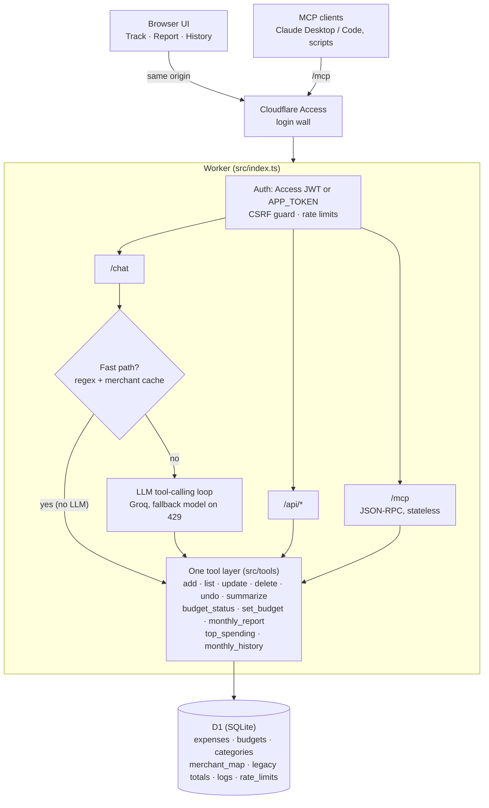

# ExpenseAgent

A personal expense tracker you talk to. Type `coffee 200, vegs 400`; it records both items with today's date (Cairo time), files them under the right categories, and shows how much of each budget you've used. Monthly reports and a 12-month history replace the Excel sheets. The same tools are available to any MCP client, such as Claude Desktop or Claude Code.

Runs entirely on Cloudflare's free plan (Workers + D1 + Access) with a free Groq model: **$0 a month, nothing running on your laptop.**

## Architecture



**Sign-in:** username and password with a 30-day session (browser autofill works); `APP_TOKEN` is the setup key for the first account and the Bearer token for scripts and MCP clients. Dark mode by default, with a light-mode switch in the header.

**Rules that keep the numbers right:** the model never writes a date, a total or a percentage. It picks a tool and fills in amount, category, note and a relative `date_token` (`yesterday`, `weekday:fri`). Code turns that into a Cairo calendar date. Every number on screen comes from SQL. Large amounts and old dates wait for a Confirm click. Every write is idempotent on its request id, and undo works for a whole message.

## Status

| Phase | State |
|---|---|
| 0–2. Setup, core tools, chat + MVP UI | Done |
| 3. Security | Done in code: Access JWT checks, fail-closed auth, rate limits, CSRF guard, CSP. Turning Access on needs your dashboard ([docs/SECURITY.md](docs/SECURITY.md)). |
| 4. Reports + History | Done: report with charts, 12-month history, month detail; reconciled against the budget table. |
| 5. Evals + optimization | Done: 82-case eval set, scorer, model/mode comparison driver, regex fast path + learned merchant cache, fallback model. **The model comparison needs your Groq key** ([eval/README.md](eval/README.md)). |
| 6. MCP | Done: `/mcp` server on the same tools, tested with the official SDK client ([docs/MCP.md](docs/MCP.md)). |
| 7. Polish + release | Done locally: this README, personal data moved out of the repo, deploy automation. Publishing the repo is your call. |
| 8. Car maintenance log | Not started: the plan starts it after launch and a 14-day trial. |

## Deploy for free (one time, about 15 minutes)

You need three free accounts: **Cloudflare** (hosting + database + login wall), **Groq** (the LLM: console.groq.com/keys) and optionally **GitHub** (automatic deploys). After this, the app runs on Cloudflare; your laptop can be off.

```bash
npm install
```

```bash
npx wrangler login
```

```bash
npm run setup:cloudflare
```

`setup:cloudflare` creates the D1 database, applies the migrations, seeds your budgets and Excel totals from `data/personal.json`, deploys, and sets the two secrets. It asks for your Groq key and generates an `APP_TOKEN`, which it shows once; save it. It is safe to re-run. Commit the `database_id` it writes into `wrangler.jsonc`.

Then:

1. Open `https://expense-agent.<your-subdomain>.workers.dev` and create your account: a username, a password, and the `APP_TOKEN` as the one-time setup key. Let the browser save the password; you stay signed in for 30 days.
2. Put **Cloudflare Access** in front (free, about 10 minutes): [docs/SECURITY.md](docs/SECURITY.md). Run its checklist before entering real data.
3. Optional: push the repo to GitHub and add `CLOUDFLARE_API_TOKEN` and `CLOUDFLARE_ACCOUNT_ID` as repository secrets. Every push to `main` then runs the tests and deploys (`.github/workflows/deploy.yml`).

**Free-tier limits that matter:** Workers allow 100,000 requests a day with 10 ms CPU per request (the LLM wait doesn't count). D1 allows 5 GB and 100,000 row writes a day. Groq's free gpt-oss-120b allows about 1,000 requests and 200,000 tokens a day, roughly 25–30 chat messages that need the model. Messages the fast path handles cost no tokens, and when the main model's quota runs out the app switches to `llama-3.1-8b-instant` for that request.

## Run locally

```bash
npm install
```

```bash
npm run db:migrate:local
```

```bash
npm run db:seed-personal:local
```

For a model, either copy `.dev.vars.example` to `.dev.vars` and add your Groq key, or keep the provided mock setup and run `node scripts/mock-llm.mjs` alongside (it only understands `item amount` messages). Then:

```bash
npm run dev
```

Open http://localhost:8787. With no auth configured, the Worker serves localhost only.

## Your data

`data/personal.json` (gitignored) holds your starting budgets and old spreadsheet totals. The format is in `data/personal.example.json`. Budgets only fill categories that have none yet, so changes made in the app are never overwritten. Spreadsheet totals are stored as monthly totals, never as fake transactions, and the import stops if a month doesn't add up to its expected total.

Other holds what is left each month after spending, invested in an index fund, gold or crypto. Entries like `thndr 3000` or `gold 2000` go there without a review flag; anything else filed as Other is flagged for review.

## Tests and evals

```bash
npm test
```

About 195 tests: Cairo dates around midnight in summer and winter time, every tool, budgets and copy-forward, reports and history (including a check that every view agrees), the fast path, the merchant cache, the `/chat` loop with a scripted LLM, the fallback model, MCP, Access JWT verification with a fake issuer, fail-closed auth, CSRF and rate limits.

```bash
npm run eval -- --mode fastpath
```

```bash
npm run eval -- --mode llm,hybrid --models groq:openai/gpt-oss-120b,groq:llama-3.3-70b-versatile,groq:qwen/qwen3-32b
```

Results land in [eval/RESULTS.md](eval/RESULTS.md). The fast-path-only run (no model) saves 30 of the 82 messages correctly with **0 false writes** and hands the other 52 to the LLM.

## Configuration

| Name | Where | Default |
|---|---|---|
| `LLM_PROVIDER`, `LLM_MODEL` | `wrangler.jsonc` vars | `groq`, `openai/gpt-oss-120b` |
| `LLM_FALLBACK_MODEL` | vars | `llama-3.1-8b-instant` (used after a 429) |
| `LLM_BASE_URL` | vars or `.dev.vars` | derived from the provider |
| `FAST_PATH` | vars | `on` (`off` sends everything to the model) |
| `LARGE_AMOUNT_THRESHOLD`, `OLD_DATE_CONFIRM_DAYS` | vars | `5000` EGP, `60` days |
| `ACCESS_TEAM_DOMAIN`, `ACCESS_AUD` | vars | empty (Access JWT check off) |
| `CHAT_RATE_PER_MIN`, `CHAT_RATE_PER_DAY`, `API_RATE_PER_MIN` | vars | `20`, `500`, `300` (0 disables) |
| `LLM_API_KEY`, `APP_TOKEN` | secrets / `.dev.vars` | none |

## Docs

- [docs/DECISIONS.md](docs/DECISIONS.md): every design decision and why
- [docs/SECURITY.md](docs/SECURITY.md): Access setup and the security checklist
- [docs/MCP.md](docs/MCP.md): connecting MCP clients; direct function calling vs MCP
- [eval/README.md](eval/README.md): running and extending the evals
- [CHANGELOG.md](CHANGELOG.md)
