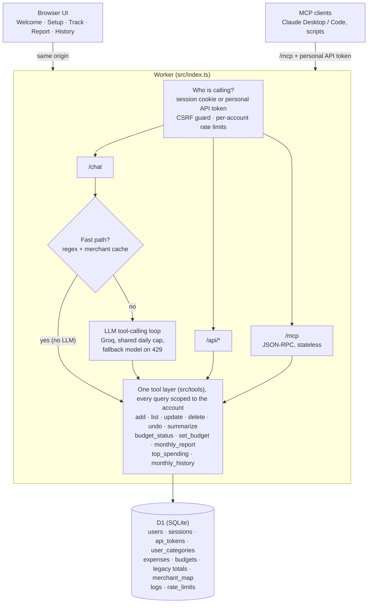

# ExpenseAgent

A free expense tracker anyone can use. Create an account with just a username and a password, then type `coffee 200, vegs 400`: it records both items with today's date in your city's time zone, files them under the right categories, and shows how much of each budget you've used. Monthly reports and a month-by-month history replace spreadsheets. Every account's data is private to that account, and the same tools work from MCP clients such as Claude Desktop or Claude Code.

Runs entirely on Cloudflare's free plan (Workers + D1) with a free Groq model: **$0 a month, nothing running on your laptop.**

## Live app

**https://expense-agent.let-apps.workers.dev**: open to anyone; sign up with a username and password.

| Part | Where it runs |
|---|---|
| App (UI, `/api`, `/chat`, `/mcp`) | Cloudflare Worker `expense-agent` on the `let-apps.workers.dev` subdomain, free Workers plan. The UI in `public/` is served by the same Worker (Workers Static Assets). |
| Database | Cloudflare D1 (SQLite) database `expense_agent`; its id is in `wrangler.jsonc`. Schema changes are the numbered files in `migrations/`. |
| AI | Groq API: `openai/gpt-oss-120b` for chat, `llama-3.1-8b-instant` as the fallback, `whisper-large-v3-turbo` for voice. The key is the Worker secret `LLM_API_KEY`, never in the repo. |
| Code | This GitHub repository (private). |

**How a change goes live.** Pushing to GitHub doesn't change the live app by itself. Either:

- **From your computer** (how it's done today): new database migrations first, then the code. On Windows PowerShell use `npm.cmd` / `npx.cmd`.
  ```bash
  npm run db:migrate:remote
  ```
  ```bash
  npm run deploy
  ```
- **Automatically from GitHub:** add the repository secrets `CLOUDFLARE_API_TOKEN` (template "Edit Cloudflare Workers" plus D1 Edit) and `CLOUDFLARE_ACCOUNT_ID` under Settings → Secrets and variables → Actions. From then on every push to `main` runs the typecheck and tests, applies migrations and deploys ([.github/workflows/deploy.yml](.github/workflows/deploy.yml)). Without those secrets, pushes only run the tests.

Cloudflare's dashboard (Workers & Pages → `expense-agent`) shows each deployed version and can roll back to an earlier one.

## Architecture



**Your own budget:** after sign-up you pick your city, your currency and up to 10 categories, from suggestions like Groceries or Investments & Savings or written in your own words, each with a monthly budget, plus an automatic Other. You can edit them any time. History starts when your account did. Categorizing learns from what you file where, so a "Healthy snacks" category catches protein bars and greek yogurt.

**City and currency:** type your city and pick it from about 7,300 cities; "today" and months follow its time zone. Pick a currency from 30 main ones or type any ISO code. Budgets and totals are in that currency; an expense in another currency (`taxi 20 USD`) is kept but not added to totals. Changing currency relabels, it never converts. Both are in the account menu.

**Quick log:** the 5 things you log most appear as one-tap buttons above the chat box, with the amount you paid last time. A tap saves it without the AI, with Undo.

**Voice and driving mode:** tap the mic next to Send and speak; it stops by itself when you stop talking and puts the text in the box. **Driving mode** is one huge button: tap, speak, and the expense is sent after a 3-second countdown you can cancel, with the screen kept on. Both are free (Groq Whisper) and work in every browser, including Brave and iPhone Safari.

**Accounts:** anyone can sign up with a username and password; no email. Sessions last 30 days and slide with use, and browser password autofill works. Every expense, budget, learned word and log row belongs to one account, and every query is limited to the signed-in account. Tests prove one account can't read, edit, delete, undo or replay another's data, even knowing its ids. Each account can create a personal API token for MCP clients. Dark mode is the default, with a light-mode switch.

**Rules that keep the numbers right:** the model never writes a date, a total or a percentage. It picks a tool and fills in amount, category, note and a relative `date_token` (`yesterday`, `weekday:fri`). Code turns that into a calendar date in the account's time zone. Every number on screen comes from SQL. Large amounts and old dates wait for a Confirm click. Every write is idempotent on its request id, and undo works for a whole message.

## Status

| Phase | State |
|---|---|
| 0–2. Setup, core tools, chat + MVP UI | Done |
| 3. Security | Done: sign-in with hashed passwords and sessions, per-account API tokens, rate limits, CSRF guard, CSP ([docs/SECURITY.md](docs/SECURITY.md)). |
| 4. Reports + History | Done: report with charts, history from sign-up, month detail; reconciled against the budget table. |
| 5. Evals + optimization | Done: 82-case eval set, scorer, model/mode comparison driver, regex fast path + learned merchant cache, fallback model. **The model comparison needs a Groq key** ([eval/README.md](eval/README.md)). |
| 6. MCP | Done: `/mcp` server on the same tools, personal tokens, tested with the official SDK client ([docs/MCP.md](docs/MCP.md)). |
| 7. Polish + release | Done: public multi-user app, deploy automation, personal data kept out of the repo. |
| After launch | Done: own categories and budgets, voice and driving mode, smarter categorizing, quick log, currency, city and time zone. |
| 8. Car maintenance log | Not started: the plan starts it after launch and a 14-day trial. |

## Deploy for free (one time, about 15 minutes)

You need a free **Cloudflare** account (hosting + database), a free **Groq** API key (the LLM: console.groq.com/keys) and, optionally, **GitHub** for automatic deploys. After this, the app runs on Cloudflare; your laptop can be off. On Windows PowerShell, type `npx.cmd` / `npm.cmd` instead of `npx` / `npm`.

```bash
npm install
```

```bash
npx wrangler login
```

```bash
npm run setup:cloudflare
```

`setup:cloudflare` creates the D1 database, applies the migrations, deploys, and asks for your Groq key, which it stores as an encrypted Cloudflare secret. It is safe to re-run. Commit the `database_id` it writes into `wrangler.jsonc`.

Then:

1. Open `https://expense-agent.<your-subdomain>.workers.dev` and create your account.
2. Attach your own numbers to it: older rows from before accounts existed, plus the budgets and spreadsheet totals in `data/personal.json`:
   ```bash
   npm run claim:remote -- <your username>
   ```
3. Share the link. Anyone can sign up for their own private account.
4. Optional: push the repo to GitHub and add `CLOUDFLARE_API_TOKEN` and `CLOUDFLARE_ACCOUNT_ID` as repository secrets. Every push to `main` then runs the tests and deploys (`.github/workflows/deploy.yml`).

**Free-tier limits that matter:**
- **Groq's free quota is shared by all accounts.** gpt-oss-120b allows about 200,000 tokens a day: roughly 25–30 messages that need the model, plus more on the fallback model. Messages like `coffee 200` that the fast path handles cost nothing and always work. `LLM_RATE_PER_DAY` (800) caps model messages per day across all accounts, and each account is capped at `CHAT_RATE_PER_DAY` (200) chat messages a day. When the quota is used up, the app says so and simple messages still work.
- **Cloudflare:** Workers allow 100,000 requests a day, and D1 allows 5 GB and 100,000 row writes a day. When a limit is hit, the app stops for the rest of the day; the free plan never bills you.
- **Sign-ups:** 5 per network a day and 300 a day in total. Set `SIGNUP_OPEN` to `"off"` to close sign-ups while keeping existing accounts.

## Run locally

```bash
npm install
```

```bash
npm run db:migrate:local
```

For a model, either copy `.dev.vars.example` to `.dev.vars` and add your Groq key, or keep the provided mock setup and run `node scripts/mock-llm.mjs` alongside (it only understands `item amount` messages). Then:

```bash
npm run dev
```

Open http://localhost:8787. Before the first account exists, localhost works without signing in. After you sign up, `npm run claim:local -- <username>` attaches your numbers there too.

## Your data

`data/personal.json` (gitignored) holds your starting budgets and old spreadsheet totals; the format is in `data/personal.example.json`. `npm run claim:* -- <username>` puts them into one account. Budgets only fill categories that have none yet, so changes made in the app are never overwritten. Spreadsheet totals are stored as monthly totals, never as fake transactions, and the import stops if a month doesn't add up to its expected total.

Other holds what is left each month after spending, invested in an index fund, gold or crypto. Entries like `thndr 3000` or `gold 2000` go there without a review flag; anything else filed as Other is flagged for review.

**Forgot a password?** There's no email, so the owner resets it: `npm run reset-password:remote -- <username>` prints a temporary password. The account's data stays.

## Tests and evals

```bash
npm test
```

About 270 tests: dates around midnight in summer and winter time, every tool, budgets and copy-forward, reports and history (including a check that every view agrees), the fast path and merchant cache, the `/chat` loop with a scripted LLM, the fallback model and the shared AI cap, MCP, quick log, currencies, per-account time zones, sign-up, sessions, API tokens and account deletion, **cross-account isolation**, Access JWT verification with a fake issuer, CSRF and rate limits.

```bash
npm run eval -- --mode fastpath
```

```bash
npm run eval -- --mode llm,hybrid --models groq:openai/gpt-oss-120b,groq:llama-3.3-70b-versatile,groq:qwen/qwen3-32b
```

Results land in [eval/RESULTS.md](eval/RESULTS.md). The fast-path-only run (no model) saves 30 of the 82 messages correctly with **0 false writes** and hands the other 52 to the LLM.

## Configuration

| Name | Where | Default |
|---|---|---|
| `LLM_PROVIDER`, `LLM_MODEL` | `wrangler.jsonc` vars | `groq`, `openai/gpt-oss-120b` |
| `LLM_FALLBACK_MODEL` | vars | `llama-3.1-8b-instant` (used after a 429) |
| `LLM_BASE_URL` | vars or `.dev.vars` | derived from the provider |
| `FAST_PATH` | vars | `on` (`off` sends everything to the model) |
| `LARGE_AMOUNT_THRESHOLD`, `OLD_DATE_CONFIRM_DAYS` | vars | `5000` (EGP accounts; other currencies use a built-in limit of about 500 USD, D45), `60` days |
| `TIMEZONE` | vars | `Africa/Cairo`, only a fallback: each account picks its own city (D46) |
| `SIGNUP_OPEN` | vars | `on` (`off` closes new sign-ups) |
| `LLM_RATE_PER_DAY` | vars | `800` model messages a day, all accounts together |
| `CHAT_RATE_PER_MIN`, `CHAT_RATE_PER_DAY`, `API_RATE_PER_MIN` | vars | `20`, `200`, `300` per account (0 disables) |
| `ACCESS_TEAM_DOMAIN`, `ACCESS_AUD` | vars | empty. Only for a private deployment behind Cloudflare Access. |
| `LLM_API_KEY` | secret / `.dev.vars` | none |

## Docs

- [docs/DECISIONS.md](docs/DECISIONS.md): every design decision and why
- [docs/SECURITY.md](docs/SECURITY.md): what protects what, and the security checklist
- [docs/MCP.md](docs/MCP.md): connecting MCP clients; direct function calling vs MCP
- [eval/README.md](eval/README.md): running and extending the evals
- [CHANGELOG.md](CHANGELOG.md)

## Credits

- City list (`public/data/cities.json`, rebuilt with `npm run build:cities`): [city-timezones](https://github.com/kevinroberts/city-timezones) (MIT), with city data from [simplemaps.com World Cities Basic](https://simplemaps.com/data/world-cities) (CC BY 4.0).
- Charts: Chart.js (MIT), vendored in `public/vendor/`.
